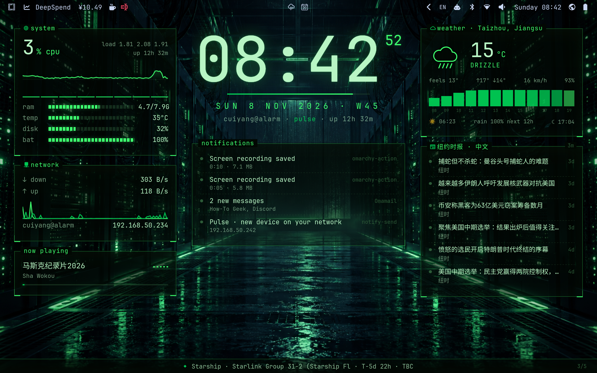

# Omarchy Pulse — a live wallpaper for Omarchy



### 🚀 后来者（或新机器）一键安装命令

任何人（或你在其他机器上）只需要在本地终端运行以下两行命令，就能直接得到和你当前完全一致的效果：

```bash
# 1. 一键下载并应用主题
omarchy-theme-install https://github.com/shawokou123/omarchy-pulse-theme

# 2. 一键激活动态壁纸与配置
~/.config/omarchy/themes/pulse/extras/install-live
```

Your desktop, alive. Pulse turns the Omarchy wallpaper into a live scene made of your own data:

- **new in 1.2: your real city** (90+, every continent), **your repositories as towers**, **the ISS and every SpaceX
  launch over your house**, your **heartbeat** on the horizon, a **crew** of friends in your sky, and **"hey sphere"**:
  talk to it ([what's new](#new-in-12))
- **the LED sphere**: a giant LED globe in the middle of the city, turning, showing your clock, weather, CPU, news,
  cameras, alerts and the face of your AI agent; it lights the plaza and shines on the wet floor
- **your AI agents are drones**: Claude Code, Codex, Grok Bot or any job fly over the city while they work, blink
  when they need you, land green (with fireworks) or red when they finish
- **the city dances with your music**, fireworks celebrate what goes right, a **focus mode** quiets everything down
- **it sees you**: the face's eyes follow your pointer, it falls asleep when you leave and, when you are back, tells
  you **what happened while you were away** (also aloud, with an offline voice)
- **your network drives on the grid**: every device is a car of light; a new one blinks and raises an alert
- **the skyline is your CPU**: one tower per core, as tall as its load; the lit windows follow your RAM
- **the horizon is your pulse**: it beats faster when the PC works, and every beat runs from the core to the edges
- **the aurora is your network**, **the sky is your real weather** (rain, snow, fog, storms), and an alert sends a
  shockwave through the city with an **INCOMING** banner

Around it, Omarchy-style panels show **any live data you want**: a command, a JSON API, a file, a stream, a camera
or anything you push from a script. Camera feeds, AI briefs, Home Assistant, servers, builds, GitHub, MQTT, logs.

Made for **Omarchy 4.5**. By [Marco Porro](https://x.com/MarcoPorro), the author of
[OmarchyTV](https://github.com/piermark/omarchytv) (the Live screen of OmarchyTV, now on your desktop).

## New in 1.2

**Your real city.** Behind the towers stands the skyline of your city, with its landmarks: the Colosseum in Rome,
the Duomo in Milan, the One World Trade Center in New York, the Eiffel Tower, Big Ben, the Burj Khalifa, the Petronas
Towers and 90+ cities from every continent. It follows the city of your weather, or pick one: `skyline = "tokyo"`.
([guide, section 22](docs/GUIDE.md#22-your-real-city))

**The Git city.** Your repositories are towers: as tall as this week's commits, with a green, red or amber beacon
for their CI. A push lights the tower up with fireworks. ([section 23](docs/GUIDE.md#23-the-git-city))

**Space over your city.** When the ISS really passes over you, you see it cross your sky. Every SpaceX launch
(Starlink, ISS crews, Starship) counts down in the ticker and on the sphere, then lifts off from your horizon. A
geomagnetic storm paints a green aurora, a solar flare flashes the sky. ([section 24](docs/GUIDE.md#24-space-over-your-city))

**Your heartbeat.** Connect your watch (Home Assistant, a script) and the horizon beats with your heart, never leaving
your PC. ([section 25](docs/GUIDE.md#25-your-heartbeat))

**The crew.** Share a code with friends: their agents fly in your sky, yours in theirs, and you celebrate each other's
finished tasks, end-to-end sealed with the code. ([section 26](docs/GUIDE.md#26-the-crew))

**Hey sphere.** Hold a key and talk: "focus 25 minutes", "how are my servers?", "what did I miss?". Offline speech to
text (whisper), only safe commands, the answer out loud, in English or Italian. ([section 27](docs/GUIDE.md#27-hey-sphere))

Try them in a minute:

```
sed -i 's/^skyline = .*/skyline = "tokyo"/' ~/.config/omarchy-pulse/pulse.toml   # your city (no line yet? add skyline = "tokyo" under [pulse])
omarchy-pulse listen                  # say "hey sphere, how are my servers?" (needs whisper.cpp or faster-whisper)
omarchy-pulse crew new                # a code for your friends
omarchy-pulse fireworks "1.2 shipped"
```

**Faster updates, smoother frames.** `omarchy-pulse perf` shows how smooth every monitor is; on NVIDIA with 4K or two
monitors, `dmabuf = "on"` (guide section 12).

## Install

```
omarchy-theme-install https://github.com/shawokou123/omarchy-pulse-theme
~/.config/omarchy/themes/pulse/extras/install-live
```

The first line installs the **pulse** theme (colours, borders, btop, two still wallpapers). The second makes the
wallpaper live: it installs what it needs (`python-gobject`, `gtk-layer-shell`, `webkit2gtk-4.1`, and `ffmpeg` /
`playerctl` if missing), asks your city for the weather and starts Pulse (optional: `sudo pacman -S cava fping
espeak-ng` for the music, every device on your network and the voice). From then on it starts at every login while
the theme is **pulse**. Run it from a terminal on the PC itself, not over SSH.

- Live with **every** theme (Pulse takes each theme's colours): `extras/install-live --always`
- Back to the pulse theme only: `extras/install-live --theme`
- Remove it (your sources stay): `extras/install-live --remove`
- Check what is missing: `omarchy-pulse doctor` · logs: `journalctl --user -u omarchy-pulse -f`

**The full guide** (every source, the AI brief, cameras, a cookbook for Zabbix, Home Assistant, Proxmox, GitHub
Actions, MQTT and more, privacy, tuning, troubleshooting): [docs/GUIDE.md](docs/GUIDE.md).

## Scenes and wallpapers

Four live scenes: **sphere** (the LED sphere in the city, the default from 1.1), **skyline** (the city of your CPU
cores around a wireframe core), **orbit** (the cores become moons around a larger core) and **calm** (a still grid,
lighter on the PC). Pick one with `scene` in `~/.config/omarchy-pulse/pulse.toml`, or in one line:

```
sed -i 's/^scene = .*/scene = "sphere"/' ~/.config/omarchy-pulse/pulse.toml    # sphere | skyline | orbit | calm
```

The wallpaper switches within about 3 seconds (`omarchy-pulse reload` to do it now).

The theme also has three still wallpapers, `01-pulse-skyline`, `02-pulse-orbit` and `03-pulse-sphere`, switched with Omarchy's
next-background key. You see them while Pulse is off or starting; they do not change the live scene.

## New in 1.1

**The LED sphere.** Thousands of LEDs on a turning globe. It shows the clock, the weather, your CPU, the latest news,
a camera, and takes over when it matters: red with an alert, a countdown in focus mode, the spectrum of your music,
the face of your agent while it works. Its light falls on the city and on the wet plaza. Two looks: `sphere = "real"`
(one continuous image) or `"led"` (thousands of separate lights).

**AI agents as drones.** Every agent at work is a drone flying over the city with its tag ("claude · omarchytv ·
editing · 4m"). A working drone scans the city with its beam, a waiting one blinks amber (it needs you), a finished
one lands green with fireworks, a failed one red with an alert. The agent's face lives in the sphere (or in the core).

```
omarchy-pulse agent grok working "reading the issue"     # any agent, any script
omarchy-pulse agent grok done
omarchy-pulse watch build -- make release                 # a drone while it runs, green or red at the end
omarchy-pulse hook claude                                 # Claude Code hooks (docs/GUIDE.md, section 16)
```

Only the agent, the tool it uses and the project folder reach the wallpaper: never your prompts or your code.

**The city dances with your music** (with [cava](https://github.com/karlstav/cava) installed): the towers, the horizon,
the floor and the sphere move with what you play, only while something plays.

**Fireworks** when an agent finishes, a focus session ends, an alert goes back to green, or whenever you want:
`omarchy-pulse fireworks "v1.1 shipped"` (`git push && omarchy-pulse fireworks "pushed"`).

**Focus mode**: `omarchy-pulse focus 25 "write the guide"` dims every panel, puts the countdown on the sphere and
under the clock, and ends with fireworks and a notification. `omarchy-pulse focus off` to stop.

**Your colours**: `[colors] preset = "synthwave" | "matrix" | "amber" | "ice" | "vapor" | "inferno"`, or `"theme"`
(the Omarchy theme in use, the default), and any single colour on top (`accent = "#39e1ff"`).

**It sees you.** The eyes of the face follow your pointer; move it on an empty desktop and the face wakes up and
looks at you. Lock the screen (or leave: hypridle can tell Pulse) and it falls asleep, z z z. When you are back it
smiles and shows **while you were away**: the alerts, the agents that finished, the new devices, the news, how many
notifications. ([guide, section 19](docs/GUIDE.md#19-the-face-that-sees-you-and-while-you-were-away))

**Your network on the grid.** Every device on your Wi-Fi is a car of light driving on the grid, with its name. A
device never seen before blinks amber and raises an alert: you know at once when something new joins your network.
Nothing leaves the PC. ([section 20](docs/GUIDE.md#20-your-network-on-the-grid))

**A voice** (off by default, offline with [piper](https://github.com/rhasspy/piper) or espeak-ng): "claude finished",
"grok needs you", "welcome back, while you were away...". Never while you share the screen, never at night.
([section 21](docs/GUIDE.md#21-the-voice))

**News**: a panel with the Omarchy releases and DHH's posts, on by default (`pulse-feed` reads any RSS/Atom feed).
**Click** a panel to run its `click = "..."` command. **The sky follows the sun**: dawn, day, dusk and night from
your weather. **Shooting stars** cross the sky when a notification or a news item arrives.

## Put anything on your wallpaper

Edit `~/.config/omarchy-pulse/pulse.toml`; when you save, the wallpaper picks it up in a few seconds. Each
`[[source]]` is a panel:

```toml
[[source]]
name = "nas"
title = "nas · disk"
command = "ssh nas df --output=pcent /volume1 | tail -1"   # anything that prints something
every = 300
warn_above = 80
crit_above = 92          # amber, red, and INCOMING when it crosses
```

| Source | What it does |
|---|---|
| `command = "..."` | runs every `every` seconds; what it prints is the data |
| `stream = "..."` | keeps running; every line is an update (`mosquitto_sub`, `journalctl -f`, `tail -f`) |
| `url = "..."` | JSON (pick a part with `path = "data.0.value"`), text or an image; `headers = { ... }` |
| `file = "..."` | read again when it changes (text, JSON or an image) |
| `camera = "rtsp://..."` | a live thumbnail through ffmpeg (`fps = 2`); `snapshot = true` polls an image URL |
| `push = true` | waits for `omarchy-pulse push` |

What a source prints decides the panel: a **number** (`42`, `21.5 °C`) is a big value with a sparkline; **text** is
typed out; JSON `{"items": [...]}` is a list (`"type": "status"` turns it into green/amber/red tiles),
`{"rows": [[k, v]]}` a table, `{"value", "unit"}` a value (`"type": "gauge"` a bar), `{"series": [...]}` a chart.
Any of them may add `"level": "ok" | "info" | "warn" | "crit"`, `"title"` and `"note"`.

More keys: `title`, `icon` (a Nerd Font glyph), `slot = "left" | "right" | "center" | "ticker"`, `order`, `type`,
`timeout`, `private = true` (hidden while you share the screen), `notify = true` (also a desktop notification).

### AI on your wallpaper

`pulse-ai` gives an AI everything your wallpaper shows and puts its brief on the desktop: what needs you first,
in four short lines. `command = "pulse-ai claude -p"`, or `pulse-ai ollama run llama3.2` to keep it all on your PC
(also `codex exec`, `gemini -p`, any CLI). Private panels are left out. Details in the [guide](docs/GUIDE.md#8-ai-on-your-wallpaper).

`pulse.toml` comes with ready examples to uncomment: an AI brief (`pulse-ai`, or any CLI that prints text), an RTSP
camera, Home Assistant, MQTT, a live log, any JSON API, pacman updates, Docker. Your own scripts go in
`~/.config/omarchy-pulse/sources/`, which is on the PATH of every source. Built in: `pulse-ping` (hosts as tiles,
`gateway` = your router), `pulse-systemd` (failed units), `pulse-table` (lines to a table), `pulse-ai`.

### Push from anywhere

```
omarchy-pulse push deploy 72 --type gauge --title "deploy"
make && omarchy-pulse push build ok --level ok || omarchy-pulse push build failed --level crit
omarchy-pulse push door ~/Pictures/doorbell.jpg
curl -s -X POST -H "X-Pulse-Token: $(cat ~/.config/omarchy-pulse/token)" \
     --data '{"value": 21.5, "unit": "°C"}' http://127.0.0.1:47800/api/push/garage
```

## Community sources

Pulse shows any live data, and the best sources come from the people who use it.
[`community/`](community/) is a growing collection of ready-made sources: Zabbix, Proxmox, GitHub
Actions, Docker, Hacker News, UniFi and more. Each one is a folder with the script, the `[[source]]` block
to paste in your `pulse.toml` and a short README.

Install one:

    cp community/zabbix/pulse-zabbix ~/.config/omarchy-pulse/sources/
    chmod +x ~/.config/omarchy-pulse/sources/pulse-zabbix

then paste `community/zabbix/source.toml` into `~/.config/omarchy-pulse/pulse.toml`.

**Made a source for your homelab, your printer, your smart home?** Open a pull request: see
[CONTRIBUTING.md](CONTRIBUTING.md). Sources run on other people's PCs, so they are read-only,
keep secrets out of the files and talk only to the service they say. Wanted: Pi-hole,
OctoPrint/Klipper, Uptime Kuma, Grafana, TrueNAS, Synology, Wazuh, Jellyfin, Tailscale.

## Built in

System (CPU, every core, RAM, GPU, temperature, disk, battery), network, weather (Open-Meteo, no key), now
playing (playerctl), your last notifications (Omarchy 4.5 or mako), GitHub (releases and commits of the repos you follow, plus your
notifications after `gh auth login`), clock and a ticker. Turn any of them off in `[builtin]`.

## Privacy

When you share or record the screen, Pulse notices (Hyprland tells it) and hides cameras, notifications, your IP and
every `private = true` panel until you stop. By hand: `omarchy-pulse privacy on | off | auto | toggle` (bind it to a
key). The hub listens only on `127.0.0.1`, every request needs the token in `~/.config/omarchy-pulse/token`
(mode 600), and camera addresses and passwords never reach the page.

## Light on the PC

The scene runs at 20 frames a second only while you look at an empty desktop; with windows open it drops to 8, with
something full screen it stops, on battery it stays at 12 at most, and a PC that cannot keep up gets fewer frames by
itself. Panels refresh once a second. Tune it in `[pulse]`: `fps`, `scene = "calm"` (still grid), `scene = "orbit"`
(the cores become moons around the core), and `gpu = "never"` on a PC without a working GPU driver. It uses
WebKitGTK: about 400 MB of memory with one monitor.

## Files

- `colors.toml`, `hyprland.conf` (cyan to magenta borders), `btop.theme`, `icons.theme`
- `backgrounds/01-pulse-skyline.png`, `02-pulse-orbit.png`, `03-pulse-sphere.png`: the stills, under the live wallpaper
- `extras/install-live`, `extras/pulse-live` (theme-set hook and login start), `extras/pulse/` (the engine:
  `omarchy-pulse`, the page in `web/`, `pulse.toml`, `sources/` with `pulse-ai`, `pulse-feed`, `pulse-ping`,
  `pulse-systemd`, `pulse-table`)
- `docs/GUIDE.md`: the full guide

## License

MIT, © 2026 Marco Porro ([x.com/MarcoPorro](https://x.com/MarcoPorro)). Weather data by
[Open-Meteo](https://open-meteo.com) (CC BY 4.0).
